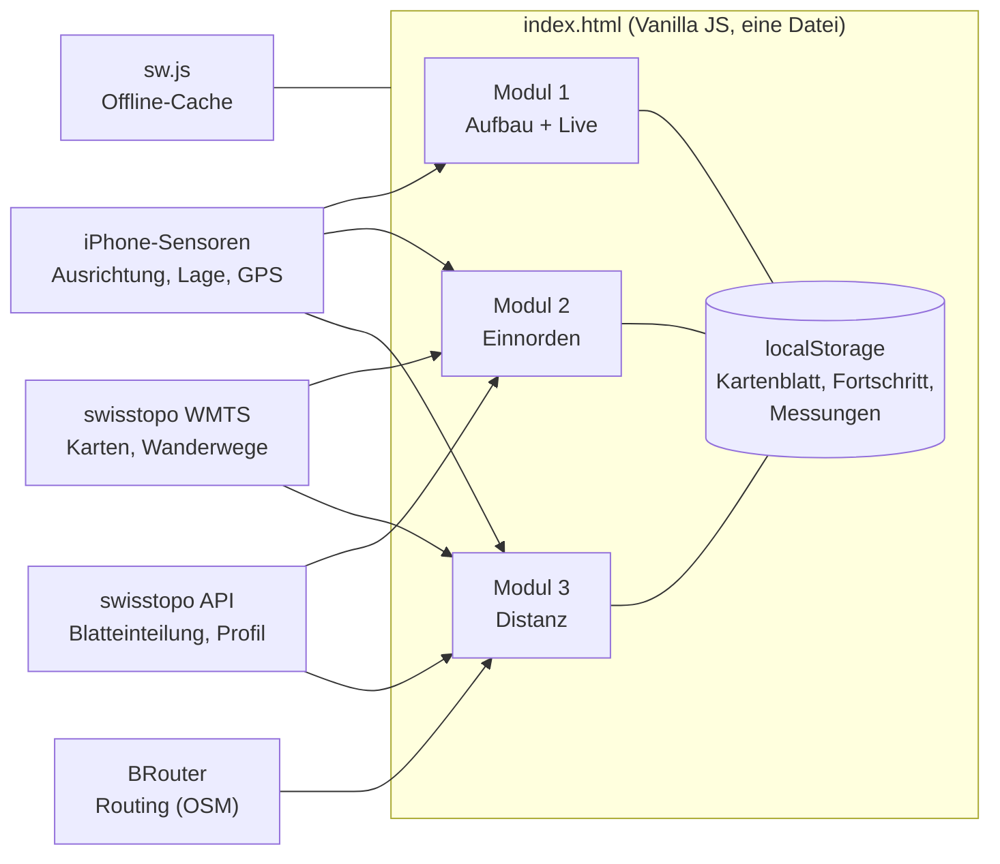

# Nordwärts

**Karte und Kompass in der Schweiz, mit dem Suunto MC-2.**

Nordwärts ist eine interaktive Lern-App für den Spiegelkompass Suunto MC-2. Sie verbindet ein nachgebautes Kompassmodell mit der echten Landeskarte von swisstopo und den Sensoren des iPhones. Jede Übung lässt sich am Bildschirm üben und danach mit dem echten Kompass und der eigenen Papierkarte im Gelände bestätigen.

**Live:** https://viv-analytics.github.io/kompass-mc2/

---

## Inhalt

- [Module](#module)
- [Installation auf dem iPhone](#installation-auf-dem-iphone)
- [Datenquellen und Lizenzen](#datenquellen-und-lizenzen)
- [Methoden und Formeln](#methoden-und-formeln)
- [Genauigkeit und Grenzen](#genauigkeit-und-grenzen)
- [Architektur](#architektur)
- [Entwicklung](#entwicklung)
- [Roadmap](#roadmap)

---

## Module

| # | Modul | Status | Inhalt |
|---|---|---|---|
| 1 | Aufbau | ✅ | 15 Teile des MC-2 (Nummern 1–11 wie in der Suunto-Anleitung, 12–15 weitere Merkmale), drehbarer Ring und drehbares Gerät, Mini-Aufgabe «Rot in Rot», Quiz, Feldübung |
| 1 | Live mit iPhone | ✅ | iPhone-Kompass, Vergleichstabelle MC-2 gegen iPhone, Hangneigung über den Lagesensor, Standort in LV95 |
| 2 | Orientierung auf der Karte | ✅ | Eigenes Kartenblatt wählen (LK25 oder LK50, nach Nummer, Name oder Standort), Karte einnorden, drei Nordrichtungen mit berechneter Abweichung von Gitternord, Live-Einnorden mit dem iPhone |
| 3 | Distanz messen | ✅ | Strecken entlang Wegen oder als Luftlinie, Weglänge in km und cm auf der Papierkarte, Höhenprofil, Gehzeit nach bfu-Faustregel und DIN 33466, Distanzen schätzen, Schrittmassstab mit GPS-Hilfe |
| 4 | Deklination | geplant | Magnetisch gegenüber geografisch Nord, Einstellen der Deklination am MC-2 |
| 5 | Navigieren | geplant | Marschrichtung von der Karte ins Gelände übertragen |
| 6 | Anpeilen | geplant | Mit Spiegel und Kimme ein Ziel anpeilen, Azimut ablesen |
| 7 | Standort bestimmen | geplant | Rückwärtseinschnitt mit zwei bis drei Peilungen, Kontrolle per GPS |
| 8 | Signale mit dem Spiegel | geplant | Signalisieren mit dem Spiegel des MC-2 |
| 9 | Hangneigung | geplant | Klinometer des MC-2, Hangneigungsklassen, Bezug zu Lawinengefahr |

Das gewählte Kartenblatt gilt für alle Kartenmodule und wird lokal auf dem Gerät gespeichert. Die App setzt kein Blatt voraus.

## Installation auf dem iPhone

1. https://viv-analytics.github.io/kompass-mc2/ in **Safari** öffnen.
2. **Teilen › Zum Home-Bildschirm.** Die App läuft dann im Vollbild und teilweise offline.
3. In Modul 1 › **Live mit iPhone** auf **Sensoren aktivieren** tippen und **Bewegung und Ausrichtung** erlauben.
4. Für die Standortfunktionen:
   - Einstellungen › Datenschutz & Sicherheit › Ortungsdienste › **Safari-Websites** auf «Beim Verwenden der App» stellen.
   - In Safari bei dieser Seite unter **Website-Einstellungen › Standort** «Fragen» oder «Erlauben» wählen.

Sensoren und Standort funktionieren nur über HTTPS. In der claude.ai-Vorschau sind sie gesperrt.

## Datenquellen und Lizenzen

| Daten | Quelle | Nutzung in der App | Bedingungen |
|---|---|---|---|
| Landeskarten 1:25 000 / 1:50 000 | swisstopo WMTS (`ch.swisstopo.pixelkarte-farbe-pk25.noscale`, `…-pk50.noscale`) | Kartenhintergrund in Modul 2 und 3 | Open Government Data, Quellenangabe «© swisstopo» |
| Blatteinteilung LK25 / LK50 | swisstopo API (`ch.swisstopo.pixelkarte-pk25.metadata`, `…-pk50.metadata`) | Kartenblatt suchen nach Nummer, Name, Standort | wie oben |
| Wanderwege | swisstopo WMTS (`ch.swisstopo.swisstlm3d-wanderwege`) | Overlay in Modul 3 | wie oben |
| Höhenprofil | swisstopo Profil-Dienst (`/rest/services/profile.json`) | Auf-/Abstieg und Profil in Modul 3 | wie oben |
| Routen entlang Wegen | [BRouter](https://brouter.de), Profil `hiking-mountain` | Weglänge in Modul 3 | Wegdaten © OpenStreetMap-Mitwirkende (ODbL); öffentlicher Server, faire Nutzung |
| Kartenbibliothek | [Leaflet](https://leafletjs.com) 1.9.4, selbst ausgeliefert (`lib/`) | Kartendarstellung | BSD-2-Clause, Lizenztext in `lib/LEAFLET-LICENSE.txt` |
| Schrift | Barlow / Barlow Condensed, selbst ausgeliefert (`fonts/`) | Typografie | SIL Open Font License, Lizenztext in `fonts/OFL.txt` |

swisstopo-Daten sind seit dem 1. März 2021 als Open Government Data frei nutzbar ([swisstopo OGD](https://www.swisstopo.admin.ch/en/free-geodata-ogd)).

Die Kompassgrafik ist eine eigene, schematische Darstellung nach Gerätefoto und Suunto-Anleitung (Abschnitt «Compass Anatomy»). Sie ist nicht massstäblich und kein offizielles Suunto-Material.

**Quellenangaben in der App:** «© swisstopo» steht direkt in beiden Karten. In Modul 3 steht zusätzlich der Hinweis auf BRouter und «© OpenStreetMap-Mitwirkende (ODbL)» mit Link zur OSM-Copyright-Seite.

**Faire Nutzung:** swisstopo-Dienste sind kostenlos, unterliegen aber einer Fair-Use-Regel; Web-Anwendungen mit durchschnittlich 20'000 Nutzerinnen und Nutzern pro Tag gelten noch als faire Nutzung. Der öffentliche BRouter-Server (finanziert vom FOSSGIS e.V.) nennt keine eigenen Nutzungsbedingungen. Bei breiter Nutzung der App sollte das Routing auf eine eigene BRouter-Instanz umgestellt werden.

## Rechtliches und Datenschutz

- Nordwärts ist ein unabhängiges Lernprojekt und nicht mit Suunto verbunden. «Suunto» und «MC-2» werden nur zur Bezeichnung des Geräts verwendet.
- Kein Backend, keine Konten, kein Tracking. Einstellungen und Messungen bleiben im `localStorage` des Browsers.
- Sensordaten (Ausrichtung, Neigung) und die GPS-Position für Standort und Schrittmassstab werden nur auf dem Gerät verarbeitet.
- Der Browser ruft direkt auf: **swisstopo** (Kartenkacheln, Blattsuche, Höhenprofil; bei «Blatt an meinem Standort» mit Koordinaten), **BRouter / brouter.de** (Routenpunkte bei «Entlang Wegen») und **GitHub Pages** (Website). Diese Dienste sehen dabei die IP-Adresse.
- Schrift und Kartenbibliothek werden von der Website selbst ausgeliefert, es gibt keine Anfragen an Google Fonts oder CDNs.
- Die gleichen Hinweise stehen in der App unter «Hinweise, Quellen und Datenschutz».

## Methoden und Formeln

### Koordinaten WGS84 ↔ LV95
Näherungsformeln von swisstopo, Genauigkeit etwa 1 m. Kontrollpunkt: Die alte Sternwarte Bern (46.95108° N, 7.43864° E) ergibt E 2'600'000 / N 1'200'000.

### Gitternord und Meridiankonvergenz
Die senkrechten Gitterlinien der Landeskarte (LV95) zeigen nicht genau nach geografisch Nord. Die App berechnet die Abweichung für den aktuellen Kartenausschnitt numerisch: Sie rechnet einen Punkt 2 km gitter-nördlich zurück nach WGS84 und bestimmt dessen Richtung. Beispiel Winterthur: +0,93°, also östlich.

### Hangneigung mit dem iPhone
Aus den Lagewinkeln des Geräts (β nach vorne/hinten, γ seitlich) ergibt sich die Neigung der Geräteebene zur Horizontalen:

```
Neigung = arccos( cos β · cos γ )
```

### Gehzeit
| Regel | Annahmen | Kombination |
|---|---|---|
| **bfu / Schweizer Wanderwege** (Hauptregel) | je 15 min pro km Distanz, pro 100 m Aufstieg, pro 200 m Abstieg | alle drei Anteile addiert |
| **DIN 33466** (Vergleich) | 4 km/h horizontal, 300 m/h Aufstieg, 500 m/h Abstieg | je für Auf- und Abstiegsabschnitte: längere Zeit + halbe kürzere Zeit |

Bei langen Routen mit viel Höhendifferenz ergibt die bfu-Regel mehr Zeit, weil sie alle Anteile addiert. Die Zeiten auf den gelben Wegweisern stammen aus einer eigenen Schweizer Formel; diese ist nicht eingebaut. Alle Zeiten verstehen sich ohne Pausen.

Quellen: [bfu-Broschüre Bergwandern](https://www.srf.ch/static/radio/modules/data/attachments/3.010_PB_Bergwandern_de.pdf), DIN 33466.

### Massstab
Karten-cm × Massstabszahl / 100 = Meter im Gelände. Bei 1:25 000 entspricht 1 cm 250 m, bei 1:50 000 entspricht 1 cm 500 m.

## Genauigkeit und Grenzen

- **iPhone-Kompass:** Safari liefert über `webkitCompassHeading` nach den verfügbaren Quellen die Richtung zu **magnetisch** Nord. Apple dokumentiert das nicht mehr aktuell. Die Vergleichstabelle in Modul 1 dient dazu, das im Feld zu prüfen. Das Magnetometer ist im Feld oft um 5–15° ungenau und wird durch Hüllen und Magnete gestört. Es ersetzt den MC-2 nicht.
- **Routen entlang Wegen:** Sie folgen dem OpenStreetMap-Wegnetz, nicht dem offiziellen Wanderwegnetz. Zur Kontrolle lassen sich die swisstopo-Wanderwege einblenden.
- **Höhenprofil:** Es folgt der berechneten Route bzw. der Luftlinie. Kleine Höhenschwankungen summieren sich zum Auf- und Abstieg.
- **Schrittmassstab mit GPS:** Die Ungenauigkeit von Start und Ziel addiert sich (meist ±10–20 m). Darum mindestens 200 m messen.
- **Deklination:** In der Schweiz beträgt sie wenige Grad Ost. Der genaue Wert folgt in Modul 4.

## Architektur



| Datei | Zweck |
|---|---|
| `index.html` | Gesamte App: Markup, CSS, JavaScript |
| `lib/` | Leaflet 1.9.4 mit Lizenz |
| `fonts/` | Barlow-Schriften mit Lizenz |
| `sw.js` | Service Worker: eigene Dateien zuerst aus dem Netz, offline aus dem Cache; Leaflet, Schriften und besuchte Kartenkacheln liegen im Offline-Cache |
| `manifest.webmanifest` | Web-App-Manifest für den Home-Bildschirm |
| `icon-*.png` | App-Symbole |

Es gibt keinen Build-Schritt und kein Backend. Alle externen Dienste werden direkt aus dem Browser aufgerufen.

## Entwicklung

```bash
git clone https://github.com/viv-analytics/kompass-mc2
cd kompass-mc2
python3 -m http.server 8000
# http://localhost:8000
```

Kartenfunktionen brauchen Internetzugang. iPhone-Sensoren lassen sich nur über HTTPS testen, also auf GitHub Pages.

**Deployment:** Jeder Push auf `main` wird über GitHub Pages veröffentlicht. Bei Änderungen die Cache-Version `V` in `sw.js` erhöhen, damit installierte Apps die neue Version laden.

## Roadmap

- Module 4–9 (siehe Tabelle oben)
- Deklination: Abweichung zwischen magnetisch und geografisch Nord aus den Feldmessungen gegenüber dem iPhone ableiten
- Native iOS-App (SwiftUI, CoreLocation) mit magnetischer und geografischer Richtung, Offline-Karten

## Lizenz

| Bestandteil | Lizenz |
|---|---|
| Code | [MIT](LICENSE), © 2026 Vivian Steiger (viv-analytics) |
| Lerninhalte (Texte, Übungen, Quiz, Kompassgrafik) | [CC BY 4.0](LICENSE-CONTENT.md), © 2026 Vivian Steiger (viv-analytics) |
| Daten, Bibliotheken, Schrift, Marken | eigene Bedingungen der Anbieter, siehe [Datenquellen und Lizenzen](#datenquellen-und-lizenzen) und [LICENSE-CONTENT.md](LICENSE-CONTENT.md) |
